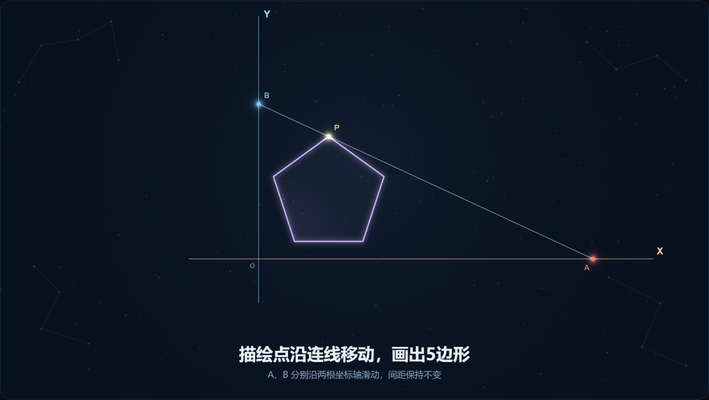

# 双点描形 · 自由轮廓资料包

版本two-point-nc-2。免费非商业试用、禁止商用，详见[LICENSE.txt](LICENSE.txt)。

让WorkBuddy从 https://github.com/chishixiaozhu/two-point-drawing 获取完整新版到新文件夹，读取其中的SKILL.md和VERSION，确认是two-point-nc-2，再提出：

> 画一个紫色五边形，保留双点沿坐标轴运动的方式，先预览。

也可以继续说“换成不规则四边形”“画四角星”“做一个叶片轮廓”。Agent负责把要求变成轮廓点，包内程序负责恒长双点计算与描绘。圆、心形、五角星仍可使用原版样式。修改都在对话里完成。

新的轮廓会等比缩放、平移适配坐标轴，保留外形比例；不保证在原点居中。支持单条闭合或开放路径；多块分离图形、带孔图形和图片精细描摹需先确认简化或拆开。

固定12秒、横屏、静音。预览满意后再说“导出视频”，打开导出页面主动点击导出；优先MP4，环境不支持时WebM。WorkBuddy内置页面不能录制或下载时用桌面浏览器。

本地需要Python 3，无第三方Python依赖，不自动安装全局软件。模型可以使用Agent自身配置的服务，不要求本地部署模型。完整输入与计算逻辑见[轮廓规则](references/contours.md)。

没有附带字体、音乐和人声；自行加入素材需确认授权。来源见[SOURCES.md](SOURCES.md)，检查范围见[TESTED.md](TESTED.md)。

已经用过旧版？请WorkBuddy重新获取完整仓库并读取新版SKILL.md，不要继续调用旧文件夹中的版本。已有作品保留。
